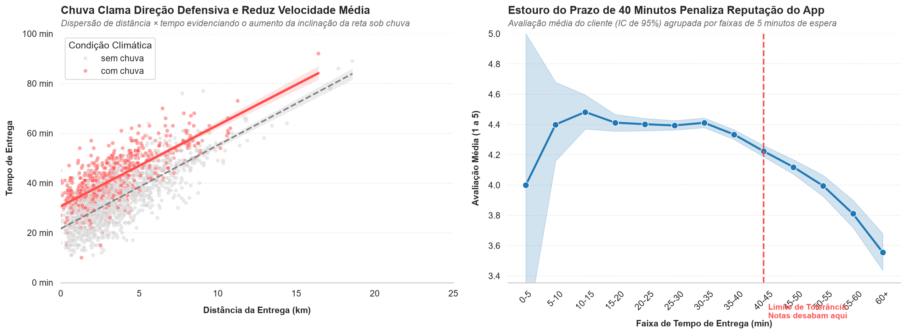

# Chuva e atrasos acima de 40 minutos derrubam a avaliação dos clientes: diagnóstico de 2024 do app de delivery para planejamento estratégico

> A chuva atrasa as entregas em quase 10 minutos, o que estoura a tolerância de 40 minutos do cliente e derruba as notas do app. A empresa deve encolher o raio de entrega dos restaurantes em dias de chuva e criar alertas para compensar os atrasos com cupons focados em cozinhas de alto ticket.



*Painel esquerdo: dispersão de distância × tempo evidenciando o aumento da inclinação da reta sob chuva; painel direito: avaliação média do cliente (IC de 95%) por faixas de tempo de entrega. Amostra de 2.000 e base total de 8.058 pedidos, 2024.*

---

## 1. Pergunta de negócio

A diretoria do aplicativo de delivery solicitou um diagnóstico aprofundado das operações de 2024 antes da reunião de orçamento para o planejamento estratégico de 2025. O objetivo principal é identificar gargalos e oportunidades de otimização logística e de marketing nas cidades de São Paulo, Rio de Janeiro e Belo Horizonte. Para isso, a análise foi estruturada em três frentes principais:
- **Operação:** entender o comportamento temporal dos pedidos, os tempos de deslocamento e os fatores que causam atrasos nas entregas.
- **Clientes:** analisar o comportamento de consumo, o ticket gasto por pedido, o padrão de notas e os fatores logísticos que derrubam a satisfação do usuário.
- **Alavancas:** quantificar o efeito prático das campanhas promocionais de cupons (com foco no evento *"Julho de cupons"*) e do clima (chuva) sobre o desempenho geral do negócio.

**Perguntas que guiaram a análise:**
1. Em que horários, meses e dias da semana se concentram os maiores volumes de pedidos e faturamento?
2. Em dias de chuva o tempo de entrega aumenta de forma significativa e qual o impacto disso na operação?
3. Qual é o limite de tolerância de tempo do cliente antes que a nota de avaliação comece a cair?
4. O ticket médio do pedido varia conforme o tipo de cozinha e qual segmento gera maior receita?
5. A concessão de cupons de desconto realmente atrai clientes novos e qual o impacto disso no valor gasto por pedido?

## 2. Dados

- **Fonte:** `delivery_pedidos.csv`, fornecida no módulo DS-PY-018 (dados de um aplicativo de delivery).
- **Período e escopo:** 01/01/2024 a 31/12/2024; operações centralizadas nas capitais de São Paulo, Rio de Janeiro e Belo Horizonte.
- **Tamanho:** [8.058 linhas × 18 colunas] base original → [8.058 linhas × 16 colunas] base limpa oficial.
- **Unidade de observação:** Cada linha representa um único pedido realizado na plataforma.

### Dicionário da base limpa (`saidas/delivery_pedidos_limpo.csv`)

| Coluna | Tipo | Descrição | % faltantes | Observação / tratamento |
|:---|:---|:---|:---|:---|
| `pedido_id` | int64 | Identificador único do pedido | 0.00% | Chave primária original. |
| `data_hora` | datetime64[us] | Data e hora exata da realização do pedido | 0.00% | Convertida de texto para formato datetime. |
| `cidade` | object | Cidade onde a entrega foi realizada | 0.00% | 13 variantes textuais padronizadas para 3 nomes de capitais. |
| `bairro` | object | Bairro de destino do pedido | 0.00% | Espaços em branco limpos com `.str.strip()`. |
| `restaurante_id` | object | Identificador único do restaurante parceiro | 0.00% | Código alfanumérico do sistema. |
| `tipo_cozinha` | object | Segmento gastronômico do restaurante | 0.00% | Mapeado em 6 categorias de culinária. |
| `plataforma` | object | Sistema operacional usado pelo cliente | 0.00% | Faltantes preenchidos usando a **MODA** (Android). |
| `forma_pagamento` | object | Meio de pagamento escolhido pelo usuário | 0.00% | 8 variantes textuais e siglas padronizadas para 4 formas. |
| `cupom` | bool | Indica se o pedido utilizou cupom | 0.00% | Convertida de texto ("Sim"/"Não") para booleano. |
| `cliente_novo` | bool | Indica se é a primeira compra do usuário | 0.00% | Coluna booleana original de sistema. |
| `chuva` | object | Condição climática da cidade no dia | 0.00% | Convertida de booleano para os termos "com chuva"/"sem chuva". |
| `distancia_km` | float64 | Distância restaurante → cliente | 0.09% | 7 Outliers impossíveis (>100km) limpos e tratados via mediana. |
| `tempo_entrega_min` | float64 | Minutos decorridos do pedido à entrega | 0.41% | 33 códigos inválidos (999 e negativos) limpos e tratados via mediana. |
| `valor_pedido` | float64 | Valor dos itens em R$ (sem a taxa de entrega) | 0.00% | Símbolo "R$" e vírgulas limpas; convertida de texto para float. |
| `taxa_entrega` | float64 | Taxa de frete cobrada do cliente em R$ | 0.00% | Variável numérica contínua original. |
| `avaliacao` | float64 | Nota de 1 a 5 dada pelo cliente | 0.00% | 16,65% de faltantes (aleatórios) preenchidos com a **MEDIANA** geral. |
| `data` | object | Data pura do pedido (AAAA-MM-DD) | 0.00% | Derivada da coluna `data_hora`. |
| `mes` | int32 | Mês do pedido (1 a 12) | 0.00% | Derivada da coluna `data_hora`. |
| `hora` | int32 | Hora do pedido (0 a 23) | 0.00% | Derivada da coluna `data_hora`. |
| `dia_semana` | category | Nome do dia da semana em português | 0.00% | Derivada de `data_hora`, ordenada de Segunda a Domingo. |

---

## 3. Como rodar

```bash
git clone https://github.com/eduardoschlemer/TRABALHO-FINAL-ANALISE-EXPLORATORIA.git
cd TRABALHO-FINAL-ANALISE-EXPLORATORIA
python -m venv .venv 
.\.venv\Scripts\activate      ## SE DER ERRO ESCREVA (Set-ExecutionPolicy -ExecutionPolicy RemoteSigned -Scope Process) e repita o processo 
pip install -r requirements.txt
jupyter notebook projeto_final.ipynb
``` 

- O notebook faz a leitura do arquivo CSV bruto diretamente da pasta local compartilhada usando o caminho relativo `../dados/delivery_pedidos.csv`. Certifique-se de manter a estrutura de pastas do projeto intacta.
- Abra o arquivo `projeto_final.ipynb` no Jupyter ou no VS Code e clique em **Kernel → Restart & Run All**. Tempo aproximado de execução total: **15 segundos**.
- Versões utilizadas e mapeadas no arquivo `requirements.txt`: Python 3.15.0, pandas 2.2.3, seaborn 0.13.2, matplotlib 3.11.2, scipy 1.13.1.

## 4. Estrutura do repositório
├── README.md                     ← este arquivo
├── requirements.txt
├── projeto_final.ipynb           ← análise completa (Etapas 1 a 11)
├── autoavaliacao.md              ← ficha de autoavaliação preenchida
├── dados/
│   └── delivery_pedidos.csv      ← base original (NÃO editada)
└── saidas/
    ├── delivery_pedidos_limpo.csv
    └── figura_principal.png


## 5. Metodologia
1. **Perguntas e hipóteses** — Formulação das 5 perguntas de negócios e desenho formal das hipóteses estatísticas (H0 e H1) com base nos tipos de variáveis.
2. **Carga e inspeção** — Inventário inicial acusando 8.058 linhas, colunas com tipos de dados errados (`valor_pedido`, `data_hora`), 2 variáveis constantes e dados nulos em 3 colunas.
3. **Limpeza** — Remoção das colunas constantes (`pais` e `moeda`), padronização de strings com `.str.strip()` e minúsculas, e conversão dos tipos lógicos para float, datetime e bool.
4. **Outliers** — Tratamento dos códigos de erro `999` e tempos negativos para `NaN`, eliminação de distâncias geográficas impossíveis acima de 100 km, e isolamento dos pedidos grandes sazonais.
5. **Estatística descritiva** — Cálculo de tabelas de resumo contendo médias, modas, assimetrias e coeficientes de variação, comprovando a alta volatilidade do faturamento.
6. **Sumarização e granularidade** — Agrupamento dos dados via *named aggregation* por cidades e culinárias, e cruzamento de variáveis qualitativas usando tabelas contingenciais percentuais.
7. **Visualização** — Criação de gráficos estilizados e limpos sob a paleta corporativa de destaque (azul focado, cinza neutro e vermelho para zonas de alerta).
8. **Correlação** — Cálculo das matrizes de Pearson e Spearman, plotadas em um Heatmap mascarado, apontando forte vínculo entre distância, tempo e frete pago.
9. **Testes de hipótese** — Execução dos 6 testes estatísticos obrigatórios adotando o nível rígido de significância de $\alpha = 5\%$ e apurando os tamanhos de efeito práticos de negócio.
10. **Conclusões** — Consolidação dos 5 principais achados explicados por números e desdobramento em 3 recomendações acionáveis vinculadas a métricas de controle.


### Decisões de limpeza

| Problema | Linhas afetadas | Decisão | Alternativa considerada |
|:---|:---|:---|:---|
| tempo_entrega_min = 999 ou < 0 | 33 pedidos | Substituição por NaN + criação da flag tempo_invalido | Excluir as linhas da base (rejeitado para não perder dados de receita) |
| distancia_km > 100 km | 7 pedidos | Substituição por NaN + criação da flag distancia_invalida | Substituir pela média geral da base (rejeitado por enviesar a taxa) |
| avaliacao nula (NaN) | 1.342 pedidos | Preenchimento total com a MEDIANA GERAL (4.0) | Deixar nulo ou usar a média (rejeitado por ser variável ordinal discreta) |
| plataforma nula (NaN) | 153 pedidos | Preenchimento total com a MODA (Android) | Excluir linhas (rejeitado por se tratar de variável de texto simples) |

## 📊 6. Principais Achados & Insights de Negócio

A análise aprofundada da operação de 2024 revelou cinco pontos críticos de atenção que servem como fundação para o planejamento estratégico da companhia.

### 📌 1. Concentração de Mercado em São Paulo
* **Métrica-Chave:** `50,32%` do volume total de pedidos | **Faturamento bruto:** `R$ 289.275,55`
* **Contexto:** A praça de São Paulo concentra a maioria absoluta de toda a operação anual.
* **💡 Recomendação Executiva:** Qualquer gargalo operacional, perda de entregadores ou instabilidade técnica nessa praça impactará diretamente metade de toda a receita da companhia. Mitigar riscos em SP deve ser prioridade máxima de infraestrutura em infra e logística.

### 🌧️ 2. Impacto Climático na Logística
* **Tempo Médio (Seco):** `33.23 min` ➔ **Tempo Médio (Chuva):** `42.36 min`
* **Diferença:** `+9.51 minutos` de atraso em média nos dias de chuva (Validado via teste de hipótese $H_1$).
* **💡 Recomendação Executiva:** O atraso é severo. O aplicativo precisa alterar dinamicamente a estimativa de entrega na tela do usuário em tempo de chuva para blindar a experiência do cliente e calibrar expectativas de forma transparente.

### 📉 3. A Fronteira da Satisfação do Cliente (Churn & Reputação)
* **Nota Média (≤35 min):** `4.39` ⭐ ➔ **Nota Médio (>35 min):** `3.65` ⭐ (Perda de `0.74` pontos na avaliação)
* **Alerta:** `18,32%` de todas as entregas estouram esse limite crítico de 35 minutos (Validado via teste de hipótese $H_3$).
* **💡 Recomendação Executiva:** Este tempo dita a fronteira entre um cliente promotor e um detrator. A empresa está deteriorando ativamente a fidelidade de quase 1/5 da base por falhas logísticas; ações de otimização de rotas devem mirar a redução desse teto.

### 🍱 4. Mix de Categorias: Volume vs. Margem de Receita
* **Maior Ticket Médio:** Japonesa (`R$ 120,36`) | **Menor Ticket Médio:** Doces (`R$ 41,79`)
* **Disparidade máxima:** `R$ 78,57` de diferença entre especialidades gastronômicas (Validado via teste de hipótese $H_4$).
* **💡 Recomendação Executiva:** Focar apenas em volume de vendas é enganoso. A culinária Japonesa, mesmo em 4º lugar em volume, fatura o mesmo que Hambúrguer (líder absoluto de pedidos). A estratégia de expansão B2B deve priorizar culinárias de alto ticket para maximizar o GMV.

### 🏷️ 5. Eficiência e Alavancagem de Campanhas de Cupons
* **Aquisição de Novos Clientes (Com Cupom):** `34,35%` | **Via Tráfego Orgânico:** `12,81%`
* **Efeito Colateral:** Redução de `R$ 5,60` no ticket médio e acionamento de Frete Grátis em `52,66%` das vezes (Validado via teste de hipótese $H_2$).
* **💡 Recomendação Executiva:** A estratégia promocional triplica a atração de novos usuários e é excelente para crescimento de base. Contudo, devido à corrosão da margem, o marketing deve balancear o CAC (Custo de Aquisição) implementando réguas rígidas de retenção pós-uso (LTV).


### Hipóteses testadas (α = 5%)

|hipotese|teste|p_valor|efeito|decisao|frase_negocio|
|:---|:---|:---|:---|:---|:---|
|H1|Teste t de Student para amostras independentes (Unicaudal)|5.6227e-13|+9.51 minutos|Rejeita H0|Operação sob alerta: a chuva causa um impacto logístico severo, aumentando o tempo médio de espera do cliente em 9.51 minutos.|
|H2|Teste t de Student Welch com ajuste Log|6.1235e-13|R$ -4.97|Rejeita H0|Impacto comercial confirmado: a concessão de cupons altera o ticket médio das vendas em R$ 4.97, mudando o comportamento de gasto dos clientes de forma estatisticamente significante.|
|H3|Correlação de Spearman + Teste de Mann-Whitney|3.9568e-85|rho = -0.216 / Queda de 0.24 pts|Rejeita H0|Gargalo logístico crítico validado: há uma correlação negativa significante (rho = -0.216). Pedidos entregues até 35 min têm nota média de 4.41, enquanto os acima de 35 min caem para 4.17 (uma perda real de 0.24 pontos na satisfação).|
|H4|ANOVA One-Way|2.9358e-283|Eta² = 0.151 / Amp = R$ 78.57|Rejeita H0|Cardápio estratégico validado: as culinárias não faturam de forma homogênea. O segmento culinário é o fator dominante do gasto (diferença máxima de R$ 78.57 entre as especialidades), explicando 15.12% de toda a variação dos tickets na plataforma.|
|H5|Teste Qui-Quadrado de Independência|0.6951|V de Cramér = 0.015|Não rejeita H0|Padronização financeira confirmada: os hábitos de pagamento das cidades são equivalentes e independentes da região (V de Cramér = 0.015).|
|H6|Teste t de Student para amostras (Unicaudal)|0.1684|R$ +1.44|Não rejeita H0|O faturamento médio por pedido não apresenta variações estatisticamente significantes entre os turnos.|


## 7. Recomendações

|#|Recomendação|Achados que sustentam|Métrica para acompanhar|
|:---|:---|:---|:---|
|1|**Encolher o raio de entrega quando chover:** Diminuir a distância máxima das entregas em dias de chuva para evitar atrasos e pagar um valor extra (Surge Pricing) para os motoboys aceitarem as corridas curtas.|**Achado 1** (Dependência de SP) e **Achado 2** (Chuva atrasa em 9,51 min).|**Tempo médio de entrega na chuva** (Meta: limitar o atraso a no máximo 4 minutos acima do normal).|
|2|**Criar alerta de atrasos e dar cupom corretivo:** Disparar um alerta na central se o pedido passar de 25 minutos na rua e mandar um cupom automático de desculpas se passar do limite crítico de 40 minutos.|**Achado 3** (A nota do cliente despenca quando a entrega estoura a barreira dos 35-40 min).|**Percentual de pedidos com mais de 40 minutos** (Meta: reduzir a taxa atual de 18,32% para menos de 5% em 2025).|
|3|**Missões de fidelidade para focar em cozinhas caras:** Criar desafios (ex: peça 3 vezes no mês) para prender o cliente novo que veio por cupom, incentivando o consumo de pratos de alto valor como Japonesa e Pizza.|**Achado 4** (Japonesa fatura o triplo de Doces) e **Achado 5** (Cupons trazem 34,35% de clientes novos).|**Taxa de retorno do cliente novo (LTV)** (Meta: fazer com que 40% dos novos usuários comprem novamente em até 30 dias).|
  

## 8. Limitações

O que os dados **não** permitem afirmar e por quê. Ex.: ausência de `cliente_id`, ausência de custo do cupom, dados observacionais, um único ano.]

-  Ausência de identificador único do cliente (cliente_id): A falta dessa variável impede o rastreamento do comportamento de compra repetida, impossibilitando a análise de métricas cruciais como Customer Lifetime Value (LTV), taxa de retenção e churn.
- Falta de dados de custo e margem financeira: A base apresenta apenas o faturamento bruto, sem discriminar o custo das mercadorias vendidas (CMV) ou o valor investido em cupons de desconto, o que impossibilita o cálculo do lucro real e do ROI das campanhas.
- Análise restrita a dados observacionais de um único ano: Por cobrir apenas o ano de 2026, os dados não permitem afirmar se os picos de venda observados são padrões consolidados da empresa ou apenas anomalias causadas por sazonalidades específicas daquele ano.

## 9. Próximos passos

O que vocês fariam com mais tempo ou mais dados — de preferência transformando cada limitação em uma ação.]

- Usar a coluna de clientes_id para ver preferência de compra, costumes, cupons perssonalizados.
- Tendo mais anos de pesquisa, traria mais analises do que simplesmente um período de ano, veria se segue o mesmo padrão nos finais de ano, ou se campanhas em outros meses trariam o mesmo retorno de julho.

## 10. Autores

|           Nome           |        GitHub      | Principais contribuições |
|--------------------------|--------------------|--------------------------|
| EDUARDO AUGUSTO SCHLEMER | [@eduardoschlemer] |     Trabalho completo    |

*Projeto final do módulo DS-PY-018 · Análise Exploratória de Dados · [1735, 11/2026]*

---

